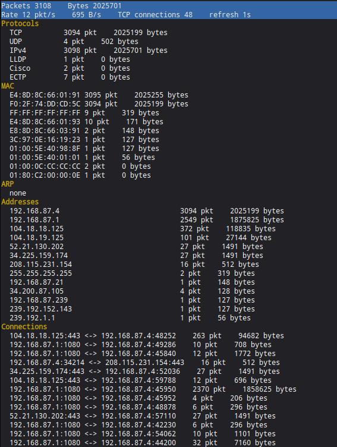
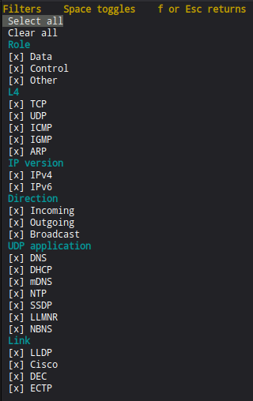

# Проект NetData

Проект на Rust для захвата и просмотра сетевых пакетов. Два приложения:

- `net_listener`: захватывает пакеты, разбирает их, показывает интерфейс в терминале и шлёт кадры `NetData` в датаграммный сокет Unix
- `net_visualizator`: нативное окно egui, которое эти кадры читает

Английская версия: [README.md](README.md).

## Что разбирает `net_listener`

Цикл захвата отдаёт каждый кадр в разбор. Ethernet II выбирается по EtherType. Кадр с полем длины (≤ 0x05DC) читается как LLC/SNAP. Внутри IPv4 и IPv6 у пакета сохраняется один протокол L4.

Непервый фрагмент IP записывается как фрагмент и не разбирается как TCP, UDP или ICMP. Первый фрагмент (смещение 0) разбирается. У IPv6 пропускаются Hop-by-Hop, Routing, Destination Options, Fragment и AH, чтобы прочитать следующий заголовок. Контрольные суммы не проверяются.

### Ethernet

| EtherType | Что сохраняется |
|---|---|
| IPv4 (`0x0800`), IPv6 (`0x86DD`) | Адреса и сообщение L4 ниже. Длина берётся из заголовка IP, дополнение Ethernet не считается. |
| ARP (`0x0806`), RARP (`0x8035`) | Только Ethernet + IPv4: операция, MAC и IPv4 отправителя и получателя. |
| MPLS (`0x8847`), MPLS multicast (`0x8848`) | Верхняя метка: номер, класс трафика, дно стека, TTL. Следующие метки не читаются. |
| LLDP (`0x88CC`) | TTL, возможности системы, адреса управления и остальные TLV (значение обрезается). |
| ECTP (`0x9003`) | Счётчик пропуска, код функции и MAC, который должен получить ответ. |

### LLC/SNAP

| OUI | Что сохраняется |
|---|---|
| Cisco `00:00:0C`, протокол `0x2000` | CDP: версия, TTL, адреса, возможности и остальные TLV (значение обрезается). |
| DEC `08:00:2B` | Только заголовок SNAP (DSAP/SSAP, control, OUI, идентификатор протокола). Тело DEC не разбирается. |

Остальные идентификаторы Cisco SNAP (CGMP, VTP, DTP, PAgP, PVST+, UDLD) и любой другой OUI сообщаются как ошибка, а не как разобранный протокол.

### Транспорт IPv4 / IPv6

| Протокол | Что сохраняется |
|---|---|
| TCP | Порты источника и назначения. |
| UDP | Порты и ярлык приложения по любому из портов. Выигрывает более конкретный: DHCP / DHCPv6 / mDNS / SSDP, затем DNS / LLMNR / NBNS / NTP, затем QUIC / WireGuard / ESP-over-UDP. |
| ICMPv4 | Echo (идентификатор, номер), Destination Unreachable (код и MTU следующего узла при коде 4), Time Exceeded, Parameter Problem, Redirect (код и шлюз), Timestamp, Router Advertisement / Solicitation. Вложенная исходная дейтаграмма и список адресов RA не читаются. |
| ICMPv6 | Echo, Destination Unreachable, Packet Too Big, Time Exceeded, Parameter Problem, NDP (Router Solicitation/Advertisement, Neighbor Solicitation/Advertisement, Redirect), MLD Query/Report/Done и MLDv2 Report. У Neighbor Solicitation сохраняется MAC источника, у Neighbor Advertisement — MAC цели. У Router Advertisement ещё до четырёх префиксов, до четырёх адресов RDNSS, первый домен DNSSL и MTU. Флаги L/A и сроки префикса не читаются. Остальные опции NDP и записи MLDv2 не читаются. |
| IGMP | Query, Report и Leave версий v1 и v2. Query и Report версии v3, не больше 16 адресов источников и 8 записей групп. |
| ESP (протокол 50) | SPI и длина содержимого. Sequence, шифротекст и ICV не читаются. |

Ярлыки UDP сверяются с телом. Тело не сошлось — ярлык снимается, остаётся обычный UDP:

- **DNS, mDNS и LLMNR** (53, 5353, 5355). Первое имя вопроса, не длиннее 64 символов, в том числе сжатое указателями. Может сохраниться первая запись SRV (порт и целевой хост). Записи обходятся в секциях answer, authority и additional; обрезанная секция останавливает обход. У mDNS ещё метки `_service._proto`, имя первой PTR, первые A и AAAA и первый TXT (строки склеиваются через пробел, не длиннее 128 символов). Адрес — первый в пакете, с хостом SRV не сверяется. У DNS и LLMNR поля `service`, `ptr`, `a`, `aaaa` и `txt` пустые; если после этого нечего сохранить, сообщение не записывается.
- **DHCPv4** (67/68) обязан нести magic cookie `0x63825363`. Опция 53 — тип сообщения (Discover, Offer, Request, Decline, Ack, Nak, Release, Inform). Опция 12 — имя хоста, опция 15 — домен (не длиннее 64 символов; непечатный байт становится `?`). Опция 50 — запрошенный IPv4, и только если в ней ровно 4 байта. Опция 3 — первый шлюз, опция 6 — до четырёх адресов DNS, опция 54 — идентификатор сервера, опция 51 — срок аренды в секундах. Список, длина которого не кратна 4, пропускается. `yiaddr` не читается.
- **SSDP** (1900). Первая строка — `M-SEARCH`, `NOTIFY` или `HTTP/1.x`. Сохраняются заголовки `NT`, `USN`, `LOCATION` (не длиннее 128 символов).
- **DHCPv6** (546/547). Тип сообщения — первый байт, типы 1–13, если сообщение достаточно длинное (не короче 4 байт, relay 12–13 не короче 34). У сообщения, которое не relay, ещё первый IAADDR внутри первого IA_NA и до четырёх адресов DNS (опция 23). Relay остаётся только типом. Идентификатор транзакции не читается.
- **NBNS** (137). Первая метка — 32 символа `A`–`P`. Сохраняются имя, суффикс, NB или NBSTAT и код операции. В ответе ещё код результата и IPv4 первой целой записи NB.

Ярлыки только по порту: NTP (123), QUIC (443), WireGuard (51820), ESP-over-UDP (4500).

Всё остальное над IP (GRE, SCTP, AH как конечный заголовок и прочие номера IANA) — неподдерживаемый протокол L4.

## Ещё не разбирается

Отложено. Без отдельной просьбы не начинать.

В локальной сети, если такой трафик есть:

- BPDU STP/RSTP (LLC DSAP/SSAP `0x42`, не SNAP).
- Проверка заголовка WireGuard на UDP 51820. Сейчас ярлык только по порту.

Внутри уже узнаваемых сообщений по-прежнему не читается:

- Остальные опции NDP у Neighbor Solicitation и Neighbor Advertisement. Префиксы и DNS там не читаются. У Router Advertisement уже есть префиксы, RDNSS, первое имя DNSSL и MTU. MAC соседа у NS и NA уже сохраняется.
- Список адресов ICMPv4 Router Advertisement.
- Записи MLDv2 Report и их списки источников. Вариант `MldV2Report` пустой.
- Списки источников IGMP v3 длиннее 16 адресов и записи групп дальше восьми.
- QUIC дальше ярлыка порта.

Контрольные суммы, сборка фрагментов, AH, GRE и SCTP не сделаны.

## Зависимости

### Ubuntu/Debian

Нужные пакеты системы:

```bash
sudo apt-get update
sudo apt-get install -y \
    libpcap-dev \
    build-essential \
    pkg-config
```

### Fedora/RHEL/CentOS

```bash
sudo dnf install -y \
    libpcap-devel \
    gcc \
    pkg-config
```

### Arch Linux

```bash
sudo pacman -S --needed \
    libpcap \
    base-devel \
    pkgconf
```

## Сборка

### Нативная (рабочий стол)

Собрать весь workspace:

```bash
cargo build --workspace
```

Отдельные бинарники:

```bash
cargo build --bin net_listener
cargo build --bin net_visualizator
```

Релизная сборка визуализатора:

```bash
cargo build --release --bin net_visualizator
```

`net_listener` нужен пакет разработки libpcap (см. «Зависимости»). Окну достаточно обычного набора Rust.

### WASM

`net_listener` для WASM не собирается: ему нужны libpcap и сырой сокет.

**Библиотека** визуализатора собирается. Время берётся из `web-time`. Клиент датаграмм Unix, `libc` и `tracing-subscriber` в эту цель не входят. На выходе `rlib`, а не страница, которую можно открыть.

```bash
rustup target add wasm32-unknown-unknown
cargo build -p net_visualizator --lib --target wasm32-unknown-unknown
```

Входа из браузера по-прежнему нет: ни `eframe::WebRunner`, ни `index.html`, ни `Trunk.toml`, ни источника по WebSocket. Бинарник `net_visualizator` остаётся нативным (`cargo build --bin net_visualizator`).

## Запуск

### Запуск net_listener

Отчёт в терминале показывает протоколы, MAC-адреса, ARP, IP-адреса и соединения TCP. Клавиша `f` открывает список фильтров. Пробел переключает галочку и запускает Select all или Clear all.





**Важно:** для захвата пакетов `net_listener` нужны повышенные права.

Вариант 1: запуск через sudo (для постоянной работы не рекомендуется)
```bash
sudo cargo run --bin net_listener
```

Вариант 2: capabilities (предпочтительно)
```bash
# Сначала сборка. .cargo/config.toml кладёт артефакты в /tmpu/NetData.
cargo build --bin net_listener

# Права на захват
sudo setcap cap_net_raw,cap_net_admin=eip /tmpu/NetData/debug/net_listener

# Запуск без sudo
/tmpu/NetData/debug/net_listener
```

### Запуск net_visualizator (нативный)

```bash
cargo run --bin net_visualizator
```

Пути сокетов можно задать:

```bash
cargo run --bin net_visualizator -- \
  --listener /tmpu/net_listener_stats2.sock \
  --socket /tmpu/net_visualizator.sock
```

Любой из процессов может стартовать первым. Визуализатор биндит `/tmpu/net_visualizator.sock` и раз в секунду шлёт приветствие на `/tmpu/net_listener_stats2.sock`, пока кадры не пойдут. Слушатель биндит свой сокет и шлёт кадры тому, кто прислал это приветствие.

Журналы: `/tmpu/net_listener.log`, `/tmpu/net_visualizator.log`.

## Если не запускается

### Ошибка: `cannot find -lpcap: No such file or directory`

Не установлен пакет разработки libpcap. Поставить его так:

**Ubuntu/Debian:**
```bash
sudo apt-get install libpcap-dev
```

**Fedora/RHEL:**
```bash
sudo dnf install libpcap-devel
```

**Arch Linux:**
```bash
sudo pacman -S libpcap
```

### Permission denied при захвате пакетов

Выдать нужные capabilities:
```bash
sudo setcap cap_net_raw,cap_net_admin=eip /tmpu/NetData/debug/net_listener
```

Дальше по отладке — в [DEBUGGING_RU.md](DEBUGGING_RU.md).
